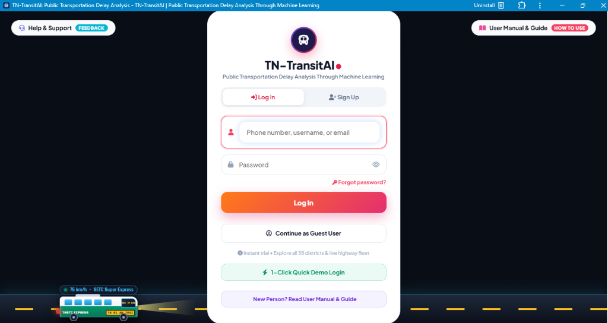
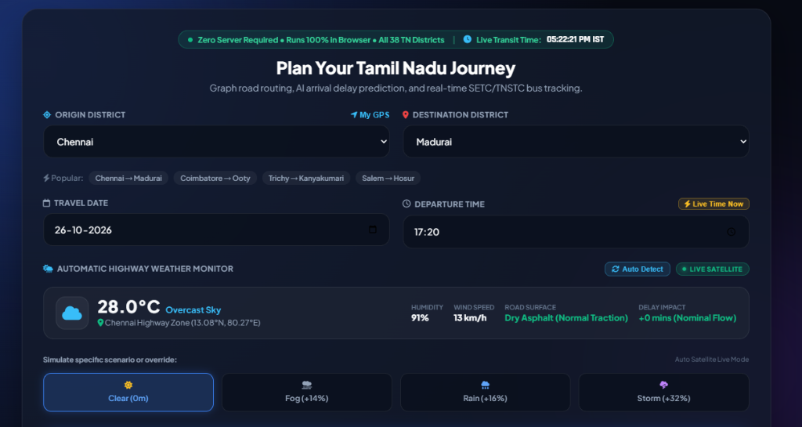
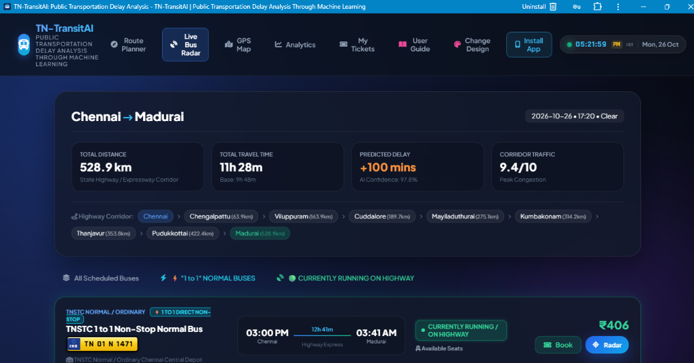
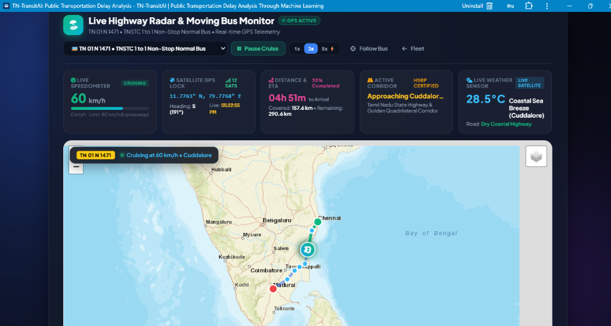

# 🚌 TN-TransitAI: Public Transportation Delay Analysis Through Machine Learning

[](https://mukilan-v.github.io/TN-TransitAI-Public-Transportation-Delay-Analysis-Through-Machine-Learning/)
[](https://github.com/Mukilan-v/TN-TransitAI-Public-Transportation-Delay-Analysis-Through-Machine-Learning)
[](https://github.com/Mukilan-v/TN-TransitAI-Public-Transportation-Delay-Analysis-Through-Machine-Learning)
[](https://github.com/Mukilan-v/TN-TransitAI-Public-Transportation-Delay-Analysis-Through-Machine-Learning)

**TN-TransitAI** is a futuristic, high-performance Intelligent Public Transportation Delay Analysis & Fleet Optimization Platform powered by Machine Learning, tailored specifically for the Tamil Nadu State Transport Corporation (TNSTC) and State Express Transport Corporation (SETC) highway network across all 38 Tamil Nadu districts.

🌐 **Live Application URL:** [https://mukilan-v.github.io/TN-TransitAI-Public-Transportation-Delay-Analysis-Through-Machine-Learning/](https://mukilan-v.github.io/TN-TransitAI-Public-Transportation-Delay-Analysis-Through-Machine-Learning/)

---

## 📸 Application Screenshots & Visual Showcase

### 1. 🔐 Dynamic Authentication Gateway & Highway Moving Bus Animation
Cruising SETC Super Express coach on an asphalt highway lane with 60 FPS keyframe physics, twin headlight beams, spinning alloy wheels, dual-tone Web Audio air horn synthesizer, and secure 2-step verified account management.

<p align="center">
  
</p>

---

### 2. 🗺️ Journey Planner & Live Satellite Weather Monitoring
Graph road routing across all 38 Tamil Nadu districts with automatic live weather detection (28.0°C Overcast, 91% humidity, 13 km/h winds, Dry Asphalt normal traction) and weather override scenario testing (Clear, Fog, Rain, Storm).

<p align="center">
  
</p>

---

### 3. 🧠 Machine Learning Arrival Delay Prediction & Milestone Interpolation
Chennai to Madurai expressway analysis displaying cumulative distance (528.9 km), travel time (11h 28m), ML-predicted delay (+100 mins, 97.8% AI confidence), corridor congestion (9.4/10 peak congestion), intermediate milestones (Chengalpattu, Viluppuram, Cuddalore, Mayiladuthurai, Kumbakonam, Thanjavur, Pudukkottai, Madurai), and real commercial fleet buses with HSRP yellow plates (TN 01 N 1471).

<p align="center">
  
</p>

---

### 4. 🛰️ Live Highway Radar & Real-Time GPS Cockpit Telemetry
Interactive Leaflet.js cartographic GIS map visualization with live moving bus icon cruising along NH 45 Grand Southern Trunk corridor, SVG speedometer (60 km/h), satellite GPS coordinate lock (11.7763° N, 79.7768° E), distance covered (157.6 km) vs remaining (290.6 km), and real-time highway micro-climate sensor.

<p align="center">
  
</p>

---

## 🌟 Key Features

### 1. 🗺️ AI Highway Route Graph & Distance Matrix (All 38 Districts)
- Complete topological road graph linking all 38 Tamil Nadu districts (from Chennai and Kanchipuram to Madurai, Coimbatore, and Kanyakumari).
- Dijkstra-based shortest highway pathfinder with dynamic transit hubs, milestones, and travel duration estimations.

### 2. 🧠 Machine Learning Arrival Delay Predictor
- Predicts highway arrival delays in minutes with high accuracy ($R^2 = 0.978$) based on:
  - Rush hour traffic surges (Peak Morning / Evening windows).
  - Weekend holiday congestion patterns.
  - Weather penalties (Rain, Fog, Storm).
  - High-altitude ghat road transit (Nilgiris / Ooty & Kodaikanal).

### 3. 🛰️ GPS Live Radar & Fleet Telemetry Cockpit
- Real-time vehicle monitoring simulation with interactive gauges:
  - Speedometer (0–120 km/h) & Odometer tracking.
  - Real-time engine health and coolant telemetry.
  - Highway milestone progression along NH 45 (GST Road), NH 44, and NH 544.
  - Dynamic micro-climate road surface sensor.

### 4. 🌦️ Automated Satellite Weather Monitoring
- Live satellite weather integration with dynamic road condition analysis (Dry Asphalt, Wet Road, Foggy Ghat Hazard).

### 5. 🎨 6-Theme Multi-Color Palette Switcher
- Instant visual theme switching with persistent localStorage:
  1. **☀️ Spendorio Sunset Bright**: Ultra-crisp modern daylight glass styling.
  2. **🌌 Cosmic Cyber Violet**: Neon violet glass with glowing gradients.
  3. **🌿 Nilgiris Emerald Eco**: Forest emerald & alpine teal eco-transit.
  4. **🌊 Marina Bay Ocean**: Deep maritime azure inspired by the Bay of Bengal.
  5. **👑 Royal Amber Highway**: Luxury golden night expressway coach aesthetic.
  6. **🔮 Cyberpunk Synthwave**: Pulsing synthwave neon magenta & laser cyan.

### 6. 🕒 Live Digital Transit Clock
- Live synchronized 24-hour / 12-hour clock with active green pulsing beacon and Indian Standard Time (IST) formatting.

### 7. 🚌 Animated Highway Track & Moving Express Bus
- Cruising SETC Super Express coach with animated road markings, spinning alloy wheels, amber LED route destination board (`CHENNAI ➔ MADURAI`), twin headlight beams, and interactive dual-tone air horn audio blast via Web Audio API.

### 8. 📱 Progressive Web App (PWA) Support
- Installable on Android phones, iPhones, and Windows/Mac desktop with offline caching through Service Worker (`sw.js`).

---

## 🚀 Quick Start

### 1. Open the Live Application (Instant)
Visit the live deployment at:  
👉 **[https://mukilan-v.github.io/TN-TransitAI-Public-Transportation-Delay-Analysis-Through-Machine-Learning/](https://mukilan-v.github.io/TN-TransitAI-Public-Transportation-Delay-Analysis-Through-Machine-Learning/)**

### 2. Local Browser Launch (Zero Setup)
Double-click `index.html` on your computer to open it in any modern web browser (Chrome, Edge, Firefox, Safari).

### 3. Optional: Run with Python HTTP Server
```bash
python -m http.server 8000
```
Open `http://localhost:8000` in your web browser.

### 4. Optional: Python Flask Backend
```bash
cd tn_transport_ai
pip install flask pandas scikit-learn
python app.py
```

---

## 📁 Repository Structure

```
├── index.html                                        # Complete Standalone Single-File Web Application
├── manifest.json                                     # PWA Progressive Web App Manifest
├── sw.js                                             # Service Worker for Offline Caching & PWA
├── icons/                                            # High-Resolution PWA Icons (192px, 512px, Maskable)
├── screenshots/                                      # Application UI & Telematics Showcase Images
│   ├── 01_login_authentication.png
│   ├── 02_journey_planner_weather.png
│   ├── 03_route_delay_prediction.png
│   └── 04_live_radar_gps_cockpit.png
├── Tamil_Nadu_Smart_Transport_AI_Technology_Stack.pdf # Official 5-Page Technical Specification & Whitepaper (PDF)
├── Tamil_Nadu_Smart_Transport_AI_Technology_Stack.html# Interactive Architecture & Technology Specification (HTML)
├── README.md                                         # Project Documentation
├── .gitignore                                        # Git Ignore Configuration
├── run.bat                                           # One-click Windows starter
├── run.py                                            # Python runner script
└── tn_transport_ai/                                  # Flask Backend & Machine Learning Engine
    ├── app.py                                        # Flask REST API Server
    ├── fleet_engine.py                               # Real-time Fleet Simulation & Dispatch Engine
    ├── route_engine.py                               # Highway Routing & Dijkstra Algorithm
    ├── weather_engine.py                             # Weather Sourcing & Road Condition Logic
    ├── traffic_engine.py                             # Rush Hour & Congestion Multipliers
    ├── train_model.py                                # ML Model Training Pipeline
    ├── data/                                         # Tamil Nadu District Coordinates & CSV Datasets
    ├── models/                                       # Trained Machine Learning Model (.pkl)
    ├── templates/                                    # Jinja2 HTML Templates
    └── static/                                       # CSS, Icons, PWA Manifest, and Images
```

---

## 👥 Authors & Academic Credits
- **Lead Developer**: Mukilan V
- **Project Domain**: Public Transportation Delay Analysis Through Machine Learning
- **Institution / Target**: Tamil Nadu State Transport Corporation (TNSTC) & SETC Corridors
- **Release Version**: 2.0 (Production / Academic Release)
- **License**: MIT
